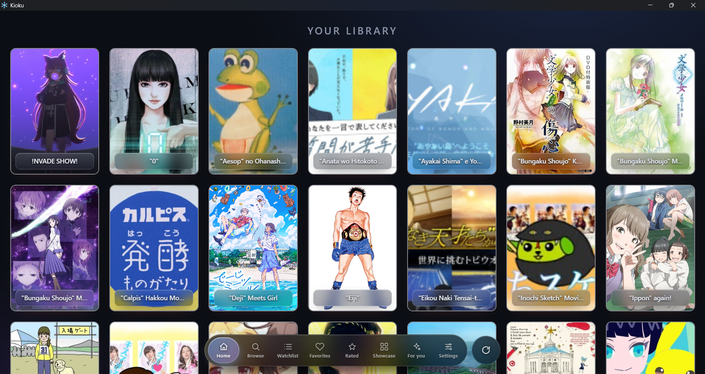
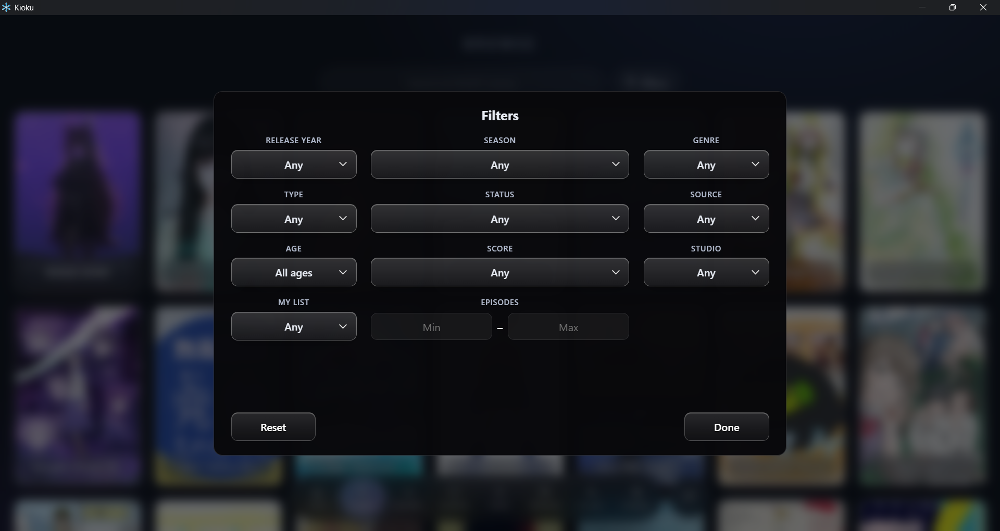
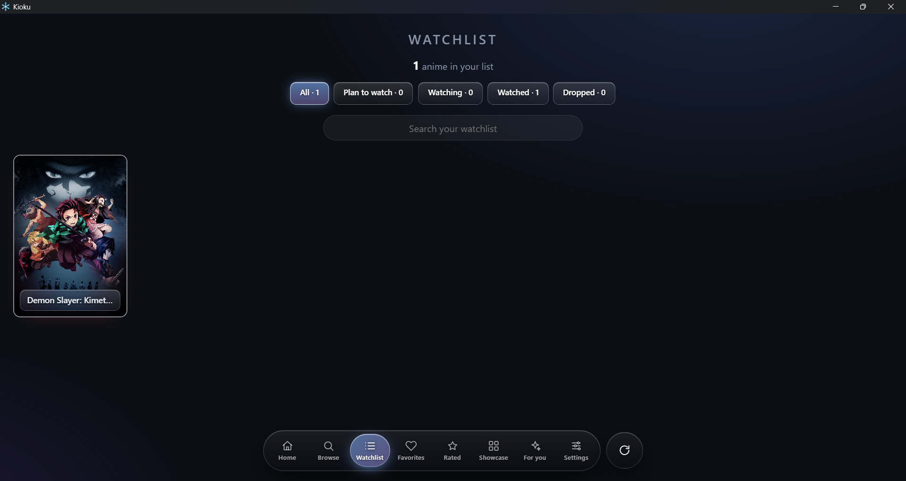
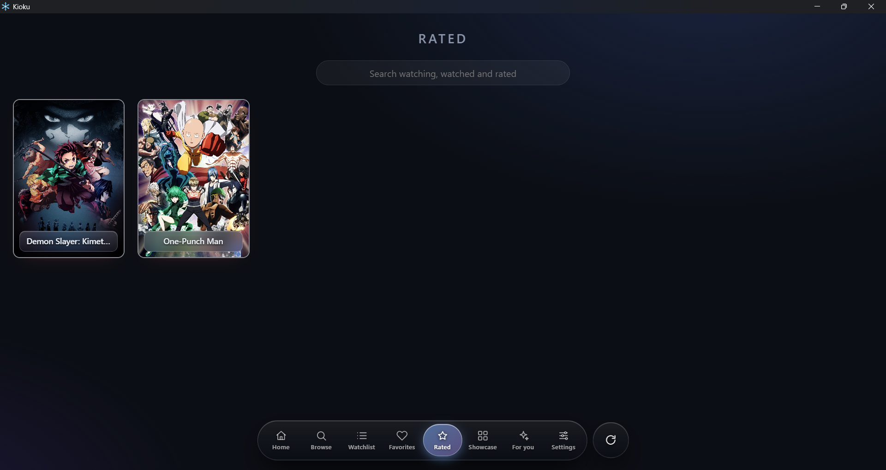
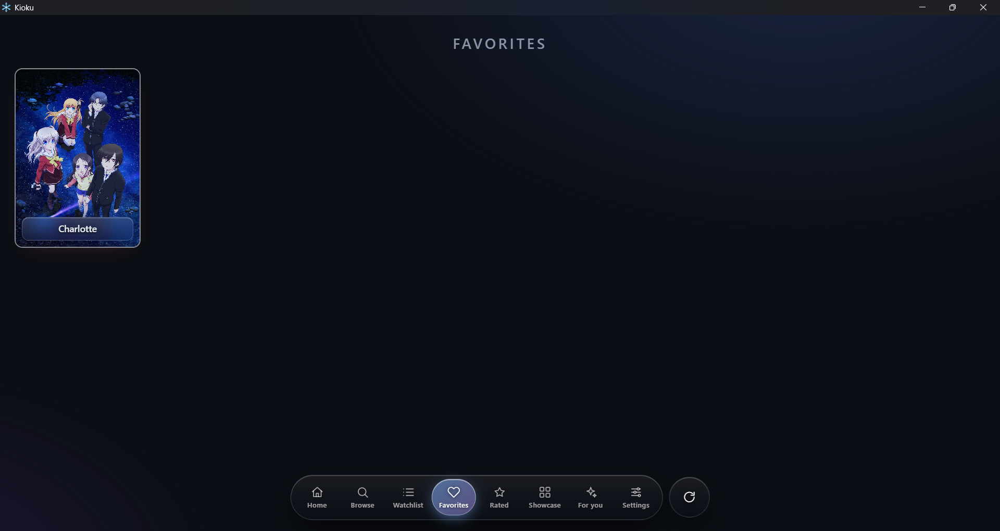
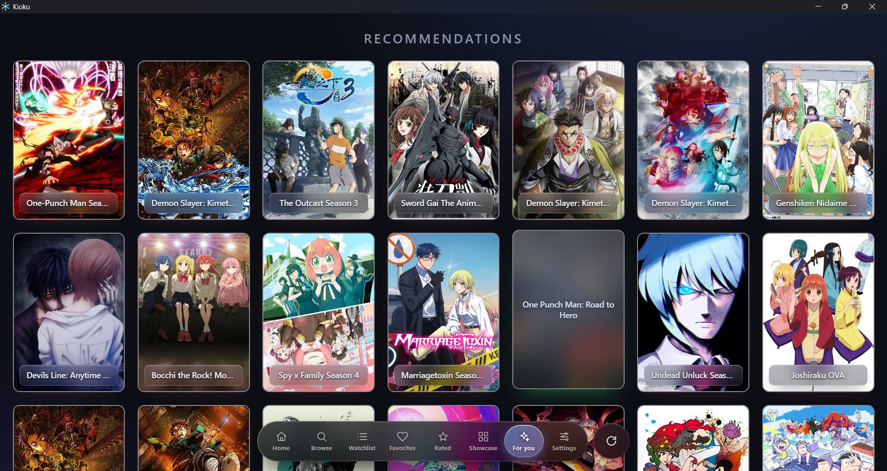
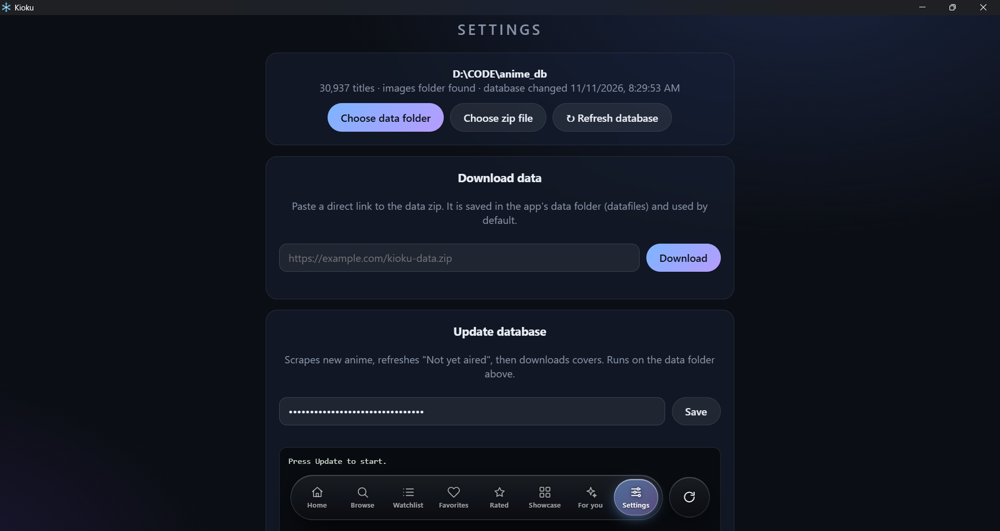
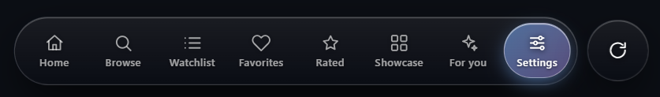

# Kioku - 記憶

### *Your anime, kept in memory.*

A desktop anime info and watch tracker with a huge offline database, 
smart filters, personal ratings and recommendations built from your own taste.

 

 

[**⬇ Download Latest Release**](https://github.com/Overlord15/kioku-release/releases/latest)

 

https://github.com/user-attachments/assets/3e3ec182-2529-451d-83ef-1cda71235325

---

## ✨ What is Kioku?

**Kioku** (記憶) is Japanese for *memory*, and that is the idea behind the app: a place that remembers every anime you have seen, planned, dropped or loved.

Kioku ships with no heavy online dependency for browsing. It works from a **local database** that lives on your own machine, so searching, filtering and scrolling through thousands of titles stays fast. When you want fresh data, built-in Python scripts update the database for you, whenever *you* decide.

---

## 🧭 Features at a Glance

| | Feature | What it does |
|---|---|---|
| 🏠 | **Home** | Every anime in one alphabetical list, from special characters to Z |
| 🔎 | **Browse** | Filter by season, year, genre, studio and format |
| 📺 | **Watchlist** | Track what you are watching, plan to watch, or dropped |
| ⭐ | **Rated** | Everything you have ever rated, in one place |
| 🏆 | **Showcase** | A read-only gallery of your rated anime |
| 💡 | **For You** | Recommendations based on the anime you scored highly |
| ⚙️ | **Settings** | Set up and update your database |
| 🔄 | **Refresh button** | Reloads the app's data right after an update finishes |

---

## 🖼️ Tour

### 🏠 Home
Browse the complete library, sorted alphabetically from special characters through **A to Z**.

 

### 🔎 Browse
Narrow thousands of titles down to exactly what you are in the mood for. Combine filters freely:

- **Season** and **Year**
- **Genre**
- **Studio**
- **Format:** TV, OVA and more

 

### 📺 Watchlist
Give every anime a status and see them grouped by it:

`Watching` · `Plan to Watch` · `Completed` · `Dropped` and more

 

### ⭐ Rate
Every anime you have scored, collected on a single page, so you can always look back at what you thought.

 

### 🏆 Showcase
A clean, **read-only** view of your rated and favourite anime. It is made for looking at and showing off, so nothing here can be edited by accident.

 

### 💡 For You
Kioku learns from your taste. Rate some anime **7 out of 10 or higher** and this tab starts suggesting titles similar to the ones you enjoyed.

> ℹ️ You need to rate at least a few anime 7/10 or above before suggestions appear.

 

### ⚙️ Settings
This is where the database is set up and kept up to date. See [Setting up the database](#-setting-up-the-database) below.

 

### 🔄 Floating Refresh Button
After a database update finishes, tap the floating **Refresh** button to reload the app with the new data. No restart needed.

---

## 🗄️ Setting up the database

Kioku needs a starting database, which is large (about **5 GB or more**), so it is downloaded separately from the app. On first launch, open **Settings** and pick whichever of the three options suits you:

| Option | Best when | What happens |
|---|---|---|
| 📦 **Choose ZIP file** | You downloaded the database zip manually | Kioku unpacks it into its install folder and uses it as the database |
| 🔗 **Paste ZIP link** | You have a direct link to the zip | Kioku downloads it, unpacks it, and uses it as the database |
| 📁 **Choose existing folder** | You already have the extracted files | Kioku simply points to that folder, with nothing copied |
|**Needs MAL Client ID to be able to Update the DB**|When you click manually update button|Finds and updates new entries of animes|

> 💡 Whichever option you use, the update scripts always run against the folder that is set as your database, so everything stays consistent.

> ⬇️ Download Database by [clicking here](https://mega.nz/file/nTxlAA5J#0rTyo6EdOC1BImx384WkyW9YJ5VyAU7W9WzB8UfHE8k). The database is mostly updated but for most recent releases database update is required.

### Keeping it fresh

Kioku includes embedded **Python** scripts that collect new and updated anime data and write it into your database. You do **not** need to install Python yourself, because it ships inside the app. Updates run only **when you ask for them**, never in the background.

---

## 📥 Installation

1. Go to the [**Releases**](https://github.com/Overlord15/kioku-release/releases/latest) page.
2. Download the latest `Kioku_x.x.x_x64-setup.exe`.
3. Run the installer and follow the steps.
4. Open Kioku, go to **Settings**, and set up your database as described above.

**Requirements**
- Windows 10 or 11 (64-bit)
- Disk space for the database (5 GB or more)
- An internet connection for the optional link download and database updates

---

## 🛠️ Built With

- [**Tauri**](https://tauri.app) with a **Rust** backend
- **HTML, CSS and JavaScript** frontend
- **Python** (embedded) for data collection and database updates

---

## 📜 License

Copyright (c) 2026 Anupam Kumar Khamrai
PROPRIETARY SOFTWARE LICENSE AGREEMENT
IMPORTANT: READ CAREFULLY. This is a legal agreement between you and the developer of this application.

1. GRANT OF LICENSE
The developer grants you a personal, non-exclusive, non-transferable license to download and use the executable binary for your personal, non-commercial use only.
2. RESTRICTIONS
You shall not, and you shall not permit others to: (a) modify, reverse engineer, decompile, or disassemble the software; (b) rent, lease, sublicense, distribute, or otherwise transfer the software to any third party; (c) remove any proprietary notices or labels.
3. PROPRIETARY RIGHTS
The software is licensed, not sold. The developer retains all right, title, and interest in and to the software, including all intellectual property rights.
4. TERMINATION
This license is effective until terminated. Your rights under this license will terminate automatically without notice from the developer if you fail to comply with any term hereof.
5. NO WARRANTY
THE SOFTWARE IS PROVIDED "AS IS", WITHOUT WARRANTY OF ANY KIND, EXPRESS OR IMPLIED. IN NO EVENT SHALL THE DEVELOPER BE LIABLE FOR ANY CLAIM, DAMAGES OR OTHER LIABILITY, WHETHER IN AN ACTION OF CONTRACT, TORT OR OTHERWISE, ARISING FROM, OUT OF OR IN CONNECTION WITH THE SOFTWARE.
6. GOVERNING LAW
This Agreement shall be governed by the laws of India. Any dispute arising out of this License shall be subject to the exclusive jurisdiction of the courts in Kharagpur, West Bengal.

---

## ⚠️ Disclaimer

Kioku is an independent project and is not affiliated with, endorsed by, or connected to any anime streaming service, database or rights holder. All anime titles, artwork and related data belong to their respective owners.

---

Made with care for anime fans &nbsp;·&nbsp; **Kioku**, *to keep in memory*

